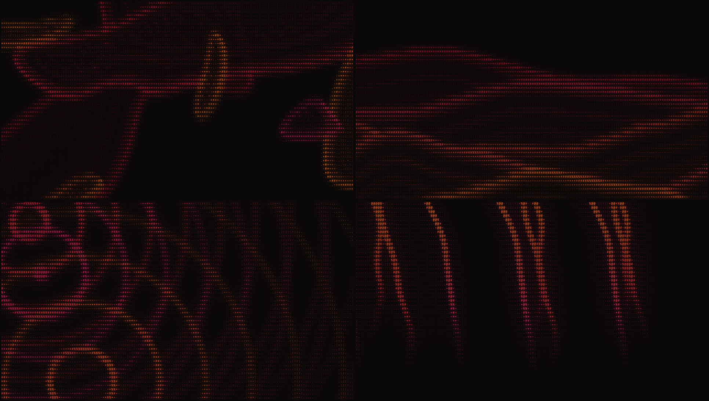

# Glyphtide

**An animated ASCII wallpaper for KDE Plasma 6.** Slow, flowing shapes drawn
entirely out of monospace characters — dense glyphs like `@%#` where a shape
is brightest, thinning to `:` and `.` where it fades.



- **Four patterns** that it cycles through, morphing slowly from one to the next
- **Per-monitor**, at your display's refresh rate
- **Light**: one GPU draw call, pauses itself under maximized windows
- **A tray icon** (`#`) with the everyday controls
- Keeps desktop icons, widgets and right-click menus working as usual

The default palette is crimson / orange / magenta on near-black, with
JetBrains Mono. All of it is configurable.

## What it is (and isn't)

Glyphtide is not a program that runs in the background. It is two small
add-ons that the Plasma desktop shell loads itself:

| Add-on | What it does |
|---|---|
| **Wallpaper plugin** | Draws the animation. Appears in the wallpaper type list next to *Image* and *Plain Color*. |
| **Tray widget** | The `#` icon in the system tray: a quick settings panel for the wallpaper. |

Nothing needs to be started at login. Once chosen, Plasma remembers it like
any other wallpaper.

## Install

Requirements: KDE Plasma 6 and a monospace font (JetBrains Mono by default).

```sh
git clone https://github.com/borislisandro/glyphtide.git
cd glyphtide
make install   # installs the wallpaper and the tray widget, adds the tray icon
make apply     # sets Glyphtide as the wallpaper on every screen
```

No compiler or Qt development packages are needed; the compiled shaders are
included in the repo.

You can also pick it by hand: *right-click the desktop → Desktop and
Wallpaper → Wallpaper type → Glyphtide*.

### Going back / removing it

- **Use a normal wallpaper again:** choose *Image* in the same wallpaper type list.
- **Remove everything:** `make uninstall`.

## Using it

Click the `#` icon in the system tray:

| Control | What it changes |
|---|---|
| Pattern | *Cycle through all*, or pin one pattern |
| Change every | How long each pattern stays when cycling |
| Speed | Animation speed; 0 freezes it |
| Glyph size | Character size in pixels; smaller means a finer grid |
| Shape size | Scale of the shapes themselves |
| Pause under maximized windows | Stop animating when the desktop is hidden anyway |

Changes apply immediately on every screen.

Colours, the glyph set, the font, glow and the frame-rate cap live in the full
settings page: *right-click the desktop → Desktop and Wallpaper*.

## Patterns

| Pattern | Looks like |
|---|---|
| **Drift** | Translucent sheets sliding over each other, each with a bright rim and faint contour lines inside |
| **Dunes** | Layered ridgelines rolling sideways, like hills receding into the distance |
| **Ripples** | Rings spreading from three slowly wandering points |
| **Aurora** | Curtains of light hanging from the top of the screen, swaying |

When cycling, the pattern is chosen from the clock, so all monitors change
together, and each change is a six-second morph rather than a cut.

## All settings

| Setting | Default | Notes |
|---|---|---|
| Pattern | Cycle | or Drift, Dunes, Ripples, Aurora |
| Change every | 10 min | only when cycling |
| Glyphs | `` .:-=+*#%@`` | the ramp, from emptiest to densest; any characters work |
| Font | JetBrains Mono | any installed font; monospace looks best |
| Glyph size | 16 px | |
| Speed | 100 % | |
| Shape size | 100 % | |
| Glow | 12 % | soft colour behind the glyphs |
| Frame rate cap | 0 | 0 follows the display; a cap skips whole frames so pacing stays even |
| Pause when covered | on | resumes the moment the window is moved or un-maximized |
| Colours | crimson theme | background plus four shape colours |

## What it costs

Measured on a 12-thread desktop with an RTX 2060 Super and two monitors
(2560×1440 at 180 Hz, 1080×1920 at 165 Hz), both animating at full refresh
rate, compared with a static image wallpaper in the same session. The desktop
was in normal use, so treat these as approximate.

| | Static image | Glyphtide |
|---|---|---|
| plasmashell CPU (share of one core) | 8–11 % | 12–16 % |
| GPU load, whole system | 28–29 % | 31–32 % |
| plasmashell video memory | 119–123 MiB | 104–108 MiB |
| plasmashell RAM growth | ~1.5 MiB/min | ~2.2 MiB/min |

- While a maximized or fullscreen window covers a screen, that screen's
  animation is paused and its CPU cost returns to the static-image level.
- **Known limitation:** on this NVIDIA + Wayland setup, plasmashell's memory
  grows slightly faster while the wallpaper is visibly animating (about
  0.7 MiB/min more than with a static image, measured over three minutes).
  Whether it levels off over hours has not been measured. Restarting
  plasmashell (`make restart`) or logging out resets it.

## How it works

Everything is one draw call whose inputs are a handful of numbers that change
each frame.

1. **The field** (`field.vert`). The screen is covered by a mesh with one
   vertex at every character-cell corner — roughly 250 × 70 on a 1440p
   monitor. The vertex shader evaluates the current pattern there and outputs
   a colour and a density. The expensive maths therefore runs a few thousand
   times per frame instead of once per pixel.
2. **The glyphs** (`glyph.frag`). Each pixel works out which cell it is in,
   reconstructs that cell's single colour and density, and draws the matching
   character from a small texture holding the glyph ramp (rendered once from
   the chosen font). Neighbouring characters in the ramp are cross-faded, so a
   cell morphs from `+` to `*` instead of snapping.
3. **Switching patterns.** The shader always knows two patterns and a mix
   factor; a pattern change animates that factor from 0 to 1.

The tray widget holds no state of its own. It reads and writes the
wallpaper's configuration through Plasma's scripting interface
(`widget/contents/tools/ctl.sh`).

## Project layout

```
package/                       wallpaper plugin
  contents/ui/AsciiScene.qml     the animation (plain QtQuick, no Plasma imports)
  contents/ui/main.qml           Plasma wrapper and pause-when-covered logic
  contents/ui/config.qml         full settings page
  contents/config/main.xml       setting names and defaults
  contents/shaders/              field.vert, glyph.frag and their compiled .qsb
widget/                        tray widget
  contents/ui/main.qml           the popup
  contents/tools/ctl.sh          get / set wallpaper settings, enable the wallpaper
tools/
  preview.py                     run the animation in a normal window
  apply.sh                       set as wallpaper on every screen
  add-to-tray.sh                 put the widget in the system tray
```

## Development

```sh
make preview                                    # live window, no wallpaper involved
tools/preview.py --set pattern=3                # 0 Drift, 1 Dunes, 2 Ripples, 3 Aurora
tools/preview.py --size 1080x1920 --seed 2.5    # portrait, another part of the field
tools/preview.py --shot out.png --time 40       # render one frame to a file
```

`tools/preview.py` needs PySide6 (Fedora: `python3-pyside6`).

| Command | Does |
|---|---|
| `make` | recompile shaders after editing them (needs `qsb`; Fedora: `qt6-qtshadertools`) |
| `make install` | install or upgrade both add-ons and re-add the tray icon |
| `make restart` | restart plasmashell, needed to load an upgraded version |
| `make apply` | set as wallpaper on every screen |
| `make tray` | put the widget back in the system tray |
| `make uninstall` | remove both add-ons |

Adding a pattern: write a `fieldSomething(vec2 px)` function in `field.vert`
that returns `vec4(colour, density)`, add it to `field()`, and add its name to
`patternNames` in `AsciiScene.qml` and to the two pattern lists in
`config.qml` and the widget.

## License

MIT
