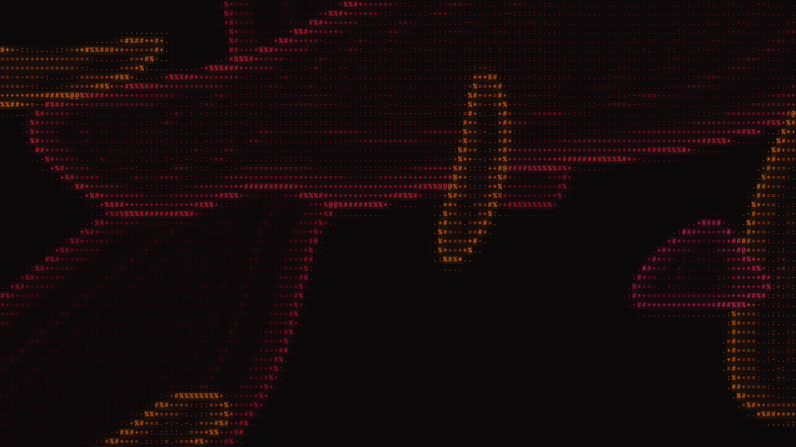

# ascii-drift

An animated ASCII wallpaper for KDE Plasma 6: translucent crimson, orange and
magenta sheets drifting slowly over black, drawn entirely in monospace glyphs.



It is a native Plasma wallpaper plugin, so it shows up in *Desktop and
Wallpaper* settings, keeps desktop icons and widgets working, and runs
independently on each monitor.

## Install

```sh
make install   # install (or upgrade) into ~/.local/share/plasma/wallpapers
make apply     # set it as the wallpaper on every screen
```

Or pick **ASCII Drift** by hand under *Right click desktop → Desktop and
Wallpaper → Wallpaper type*. To go back, choose *Image* there again.

Requirements: Plasma 6 and a monospace font (default: JetBrains Mono). The
compiled shaders are committed, so no build tools are needed to install.

After upgrading an already-running version, run `make restart` (restarts
plasmashell) to load the new code.

## Settings

| Setting | Default | |
|---|---|---|
| Glyphs | `` .:-=+*#%@`` | the ramp, from emptiest to densest |
| Font / glyph size | JetBrains Mono, 16 px | smaller = finer grid |
| Speed | 100 % | 0 freezes it |
| Shape size | 100 % | |
| Glow | 12 % | soft colour behind the glyphs |
| Frame rate cap | 60 | 0 follows the display refresh rate |
| Pause when covered | on | stops animating under a maximized/fullscreen window |
| Colours | CrimsonDark palette | background + four sheet colours |

## How it works

Two fragment shaders, so the cost is close to nothing:

1. `field.frag` runs at **one pixel per character cell** (about 250 × 70 on a
   1440p screen). It layers four domain-warped noise "sheets" and outputs a
   colour and a density per cell. The distance to each sheet's outline is
   estimated from the noise gradient, which gives a dense rim of constant
   width, a stippled interior and fading contour lines.
2. `glyph.frag` runs at full resolution and only does lookups: cell → field
   texture → glyph from an atlas that QML renders once from the chosen font.
   Adjacent glyphs in the ramp are cross-faded so density changes morph
   instead of popping.

```
package/                     the Plasma wallpaper package
  contents/ui/AsciiScene.qml   the animation (pure QtQuick)
  contents/ui/main.qml         Plasma wrapper + pause logic
  contents/ui/config.qml       settings page
  contents/shaders/*.frag      shader sources (+ compiled .qsb)
tools/preview.py             run the scene in a window (needs PySide6)
tools/apply.sh               set as wallpaper on all screens
```

## Hacking

```sh
make preview                                   # live window
tools/preview.py --size 1080x1920 --seed 2.5   # portrait, other part of the field
tools/preview.py --shot out.png --time 40      # render one frame
```

Editing a `.frag` needs `qsb` (Fedora: `qt6-qtshadertools`); `make` rebuilds
the `.qsb` files.

## License

MIT
